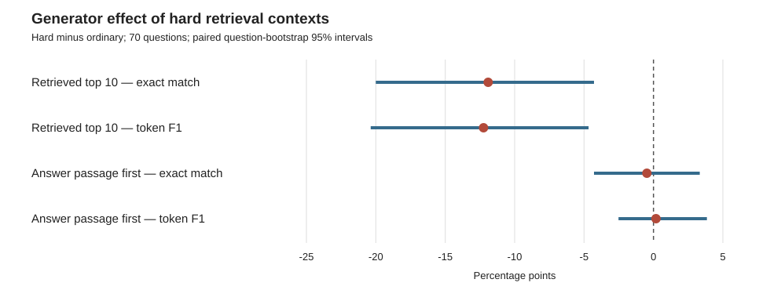

# Generator evaluation: ordinary and hard retrieval contexts

**Status:** complete. This is a post-hoc supplementary experiment added after the retrieval-only results. It does not change the predeclared retrieval threshold or its analysis.

## Question

Does a language model still answer correctly when it receives the actual top 10 passages from the ordinary versus hard-mixed BM25 retrieval runs? If the known answer-bearing passage is supplied first in both conditions, does the difference remain?

## Data and procedure

- Benchmark: 100 frozen BEIR Natural Questions queries, the same three corpus draws (seeds 11, 23, 37), and the same ordinary/hard retrieval results used in the completed secondary retrieval arm.
- The hard-passage candidates had AI-assisted screening followed by the author's manual review of passages and labels. This was one author's review, not independent double annotation.
- Generator: `Qwen/Qwen3-4B`, greedy decoding (`do_sample=false`), with one fixed prompt and a 128-token output limit. The prompt requested a short answer and an exact evidence quote. The model checkpoint was loaded by repository name without an immutable commit hash recorded; this limits exact model-version reproducibility.
- **End-to-end context:** the top 10 passages returned by the corresponding ordinary or hard-mixed BM25 corpus.
- **Answer-passage-first context:** the same selected answer-bearing qrel passage was placed first in both conditions, followed by the top nine non-qrel passages from that condition. This is a sensitivity experiment that tests the generator when the answer passage is made easy to find; it is not the natural retrieval result.
- The maximum input length was 3,800 tokens. The observed inputs ranged from 978 to 2,652 tokens, so no prompt reached the cap. Decoding was deterministic. The first 301 outputs were generated sequentially on a T4; the remaining 899 were generated in batches of eight on an A100. A 60-output pilot check found 55 directly matching parsed answers; the other five were invalid-JSON pilot records whose raw outputs contained an answer recovered by the final parser.
- Total: 1,200 outputs (100 queries × 3 draws × 2 retrieval conditions × 2 context setups), with all 1,200 records and context text retained in `generator_full.jsonl`.

## Answer references and scoring

The public DPR Natural Questions test-reference file `answer_data/nq-test.json.gz` supplies answer aliases. We matched queries by exact text after case, Unicode, punctuation, and whitespace normalization. This produced references for 70 of the 100 queries. The other 30 are retained in the output but excluded from answer-accuracy scores; no answer keys were invented for them.

We report SQuAD-style exact match (EM) and token F1, taking the best match across each question's reference aliases. Scores are averaged over the three draws for each question. The 95% intervals are paired question-cluster bootstrap intervals (10,000 resamples, seed 20261029). The comparison is exploratory and evaluates one model on one benchmark.

## Results

| Context given to generator | Ordinary EM | Hard EM | Hard − ordinary (95% CI) | Ordinary F1 | Hard F1 | Hard − ordinary (95% CI) |
|---|---:|---:|---:|---:|---:|---:|
| Retrieved top 10 | 57.6% | 45.7% | −11.9 pp (−20.0, −4.3) | 67.4% | 55.1% | −12.2 pp (−20.4, −4.7) |
| Answer passage first | 60.5% | 60.0% | −0.5 pp (−4.3, +3.3) | 73.3% | 73.5% | +0.2 pp (−2.5, +3.9) |

In the full 100-query retrieval set, a qrel-positive passage appeared in the top 10 for 90.7% of ordinary results and 82.3% of hard-mixed results. Within the 70-query answer-scored subset (210 query-draw contexts per condition), the first qrel passage was at rank 1 in 152 ordinary contexts and 82 hard contexts; it was absent from 21 ordinary and 31 hard contexts. Hard retrieval therefore more often omitted or pushed the answer passage lower.

**Interpretation:** end-to-end answers were less accurate under the hard retrieval condition. When the same answer-bearing passage was placed first in both contexts, the measured difference was close to zero, with an interval that includes small effects in either direction. In this experiment, the evidence points mainly to retrieval placing the answer passage lower or leaving it out; it does not show that this model consistently fails to use the answer passage when it is supplied first. The result is limited to Qwen3-4B and this prompt and benchmark.

An AI-assisted qualitative review of the 16 questions where exact-match outcomes differed between conditions found that several hard-context errors coincided with the answer passage moving from rank 1 to a lower rank or out of the top 10. Examples include Wake Island (ordinary: “January 17, 1899,” gold rank 1; hard: “October 1945,” gold absent) and Teenage Mutant Ninja Turtles (ordinary: “1984,” gold rank 1; hard: “1989,” gold ranks 8–9). The review also found metric edge cases: a complete list of all accepted FIFA host-country answers was marked EM-incorrect; “1954” was scored as different from a full date; and an answer with the correct ocean plus a date was marked EM-incorrect. The primary EM/F1 results were not changed after this review.

The model was also asked for a verbatim evidence quote. Exact quote-substring checks found that 86.4%–88.5% of nonempty quotes appeared in the supplied passages. This mechanical check does not establish that the quote supports the answer. Thirty-seven outputs needed a fallback answer-field parser because the model emitted invalid JSON; their raw text is retained.

## Limits and reproducibility

- This was added after seeing the retrieval results, so it is exploratory rather than preregistered.
- Only 70 queries have matched public DPR answer aliases. Exact match can undercount valid paraphrases and answers with extra correct detail, as the qualitative review showed. No independent human answer annotation was performed.
- A single 4B model, one prompt, one decoding setup, and general-domain NQ passages do not support claims about generators in general or biomedical RAG.
- The answer-passage-first comparison deliberately changes the context by putting one answer passage at rank 1. It isolates performance when evidence is made prominent; it does not estimate ordinary production behavior.
- Raw generation output, answer references, passage IDs/text, and contexts are in `generator_full.jsonl`. The input bundle is `generator_inputs.jsonl.gz`. Run `python3 analyze_generator.py` in this directory to regenerate the summary, question-level CSV, and figure. `run_generator.py` is the Colab inference script.
- No paid model API calls were made. Colab GPU work used about 1.7 compute units. The A100 and T4 sessions were stopped after the output was downloaded.

## Figure

## Source for answer references

- [DPR Natural Questions test retrieval results](https://dl.fbaipublicfiles.com/dpr/data/retriever_results/single/nq-test.json.gz), containing question strings and answer aliases. We use its answer aliases only after exact normalized question matching.
